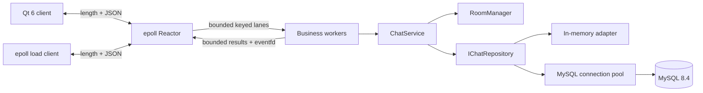
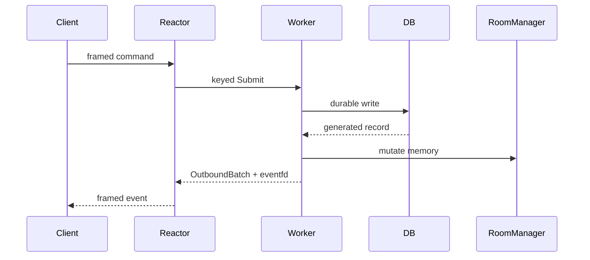
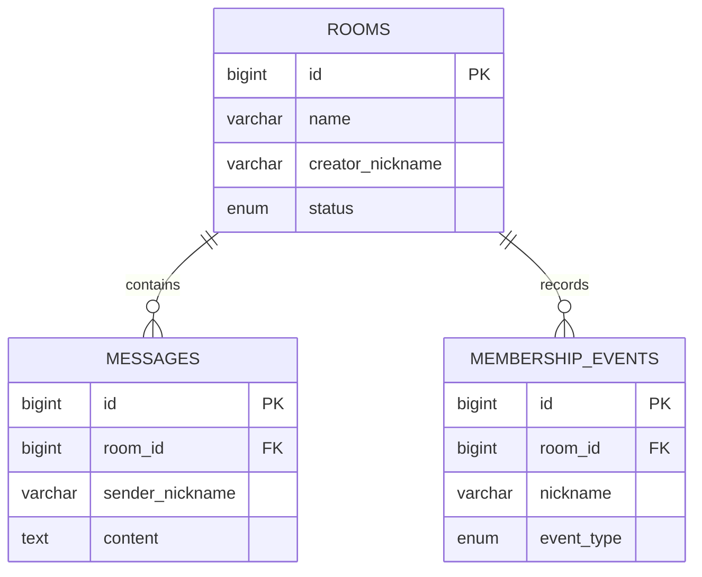

# Architecture

Only the Reactor thread owns descriptors, epoll state, decoders, and connection
output buffers. Commands are assigned by connection id to one fixed executor
lane, preserving FIFO without serializing unrelated connections. Worker results
carry both connection id and generation; the Reactor discards stale deliveries.
The result queue blocks business workers when full, rather than dropping a
persisted operation's outbound events. A disconnect whose keyed lane is full
stays in a retry list until cleanup can be queued in that lane. On shutdown,
the listener closes first, submitted work and outbound data are drained up to
the configured output deadline, then sockets are closed and disconnect cleanup
finishes before the executor is destroyed.

Explicit create, join, leave, and chat are durable-first. Disconnect is the
intentional exception: memory membership is removed and peers are notified
before a best-effort LEAVE write, so dead sockets cannot remain online.
Join and leave take an exclusive room-stripe lock. Chats take a shared lock,
allowing different connections in the same room to enter the bounded MySQL
batch writer concurrently while keeping membership changes out of the write
window. The keyed executor still preserves each connection's command order;
different connections do not have a receive-order guarantee. The MySQL adapter
returns message IDs only after the containing transaction commits, and the
service broadcasts only those committed messages.

